# Memory benchmarks

How well VOOL remembers a long conversation, measured on [LoCoMo](https://github.com/snap-research/locomo)
(long multi-session chats with questions about them), against two other open-source agents with their own
memory, Hermes Agent and OpenClaw, and against simply pasting the whole chat into the prompt.

Every run below is listed, including the ones that went worse for VOOL. All runs were made in October 2026
on research builds of VOOL's memory (named v7 to v14 here). VOOL 0.7 ships the v14 memory with later
fixes to forgetting; that shipped build was checked on the official 150 too (123 of 150, see
[VOOL 0.7's own build](#vool-07s-own-build-on-the-official-150)).

## The short version

| Run | Questions | VOOL | OpenClaw | Hermes | Is VOOL's lead more than noise? |
| --- | --- | --- | --- | --- | --- |
| [Official round](#official-round-150-never-used-questions) | 150, never used before | **124 (82.7%)** | 107 (71.3%) | 94 (62.7%) | Yes: p = 0.005 vs OpenClaw, p < 0.001 vs Hermes |
| [Round 3](#round-3-130-unseen-questions) | 130, never used before | **102 (78.5%)** | 93 (71.5%) | 95 (73.1%) | No: p = 0.24 and 0.30 |
| [Pilot](#pilot-200-questions-vool-was-developed-on) | 200 VOOL was tuned on | **163 (81.5%)** | 142 (71.0%) | 139 (69.5%) | Yes on paper, but the lead is inflated (see below) |
| [VOOL 0.7's own build](#vool-07s-own-build-on-the-official-150) | the same official 150 | 123 (82.0%) | not rerun | not rerun | Level with v12's 124: 7 gained, 8 lost, p = 1.0 |
| [Full LoCoMo](#full-locomo-all-1986-questions) | all 1,986 | 1,645 (82.8%) | not run | not run | Ties the whole-chat-in-the-prompt baseline (1,650); p = 0.82 |

On the official round VOOL also used 3.5 to 5.4 times fewer tokens per question, cost a third of OpenClaw's
price and 28% less than Hermes's, and answered fastest. It was weakest where everyone was weak, on multi-hop
questions that join facts from several sessions.

p-values are exact McNemar tests on the questions both systems answered (only one right vs only the other).

## Official round: 150 never-used questions

6 October 2026. 150 LoCoMo questions that had never been selected or scored in any VOOL run, picked by a
fixed seed before any answer.

* **Same reader for all three:** GLM 5.3 flashx (`z-ai/glm-5.3-flashx` on OpenRouter), reasoning low, the
  same answer instruction.
* **Grader:** GPT-4o (`gpt-4o-2024-08-06`) with LongMemEval's answer-check prompt, the same for all three.
  LoCoMo's own F1 is reported alongside.
* **Systems:** VOOL v12; Hermes with background review on (its recommended setting); OpenClaw with its
  native settings. Each system ingested the same 10 conversations, then every answer started from a copy
  of that system's store.
* **Fair turns:** all three ran on one Mac, one answer in flight at a time, the system order rotating per
  question, with the machine's load recorded before and after every answer.

| | VOOL v12 | OpenClaw | Hermes |
| --- | --- | --- | --- |
| Right (GPT-4o grader) | **124 / 150 (82.7%)** | 107 / 150 (71.3%) | 94 / 150 (62.7%) |
| Partly right | 6 | 2 | 0 |
| Said it did not know | 2 | 10 | 21 |
| Confidently wrong | 18 | 31 | 35 |
| LoCoMo F1 (mean) | 0.520 | 0.321 | 0.237 |
| Billed cost per question (answering) | $0.0033 | $0.0100 | $0.0046 |
| Tokens per question | 9.6k | 51.8k | 33.5k |
| Share of prompt tokens served from cache | 14% | 65% | 86% |
| Model calls per question | 3.01 | 4.02 | 6.51 |
| Answer time, median / p90 | 11.2 s / 14.4 s | 15.6 s / 24.0 s | 16.2 s / 30.0 s |
| Ingestion per conversation (median) | 62.5 s | 12.5 s | 2.8 s |

Matched on all 150: VOOL vs OpenClaw, only VOOL right 25, only OpenClaw right 8 (p = 0.005); VOOL vs Hermes
39 vs 9 (p < 0.001); Hermes vs OpenClaw p = 0.08.

**Later VOOL builds on the same 150.** v13 and v14 each answered the same 150 afterwards, alone, with the
same reader and grader: v13 got 126 and v14 got 125. Against v12 neither change is more than noise
(v14 vs v12: 6 vs 5 questions, p = 1.0). v14 vs OpenClaw on the same questions: 23 vs 5, p = 0.0009. None
of v12, v13 or v14 answered any of the 16 questions labelled critical wrongly; Hermes answered 2 of them
confidently wrong and OpenClaw declined 1. Answer times for v13 and v14 come from solo runs, so they are
not compared with the rivals' times.

**Ingestion.** VOOL is the slowest to ingest because it embeds every turn on the machine
(nomic-embed-text). Ingestion happens once per conversation and is not counted in answer time.

### VOOL 0.7's own build on the official 150

10 and 11 October 2026. Before VOOL 0.7 shipped, the release candidate of its memory (v14 plus the
forgetting and missing-fact fixes that went into 0.7) answered the same official 150 as a ship check, with
the same reader (GLM 5.3 flashx, temperature 0, reasoning low, output cap 2048) and grader (GPT-4o
`gpt-4o-2024-08-06`, temperature 0, the same frozen LongMemEval prompt).

| | VOOL 0.7 build | VOOL v12 (official round) |
| --- | --- | --- |
| Right | 123 / 150 (82.0%) | 124 / 150 (82.7%) |
| Non-adversarial right | 92 / 115 | 92 / 115 |
| single-hop / adversarial / temporal / multi-hop / open-domain | 54 / 31 / 22 / 11 / 5 | 54 / 32 / 23 / 10 / 5 |
| LoCoMo F1 (mean) | 0.545 | 0.520 |
| Reader tokens per question | 11.4k | 9.6k |
| Time per question, median | 21.0 s (whole workflow) | 11.2 s (answer only) |

Matched against v12: 7 questions gained, 8 lost, exact McNemar p = 1.0, so the shipped build is level with
the build that beat Hermes and OpenClaw, not better or worse. The two times are measured differently and are
not comparable. Hermes and OpenClaw were not rerun.

The same check also started the full 1,986-question set and **did not finish**: one provider call failed
with a network error and the run stopped after 1,603 questions were attempted (1,600 scored; 2 empty
replies from the provider went unscored). There is no full-set score for the 0.7 build. On the 1,600
questions both builds answered, it got 1,290 (80.6%) against v14's 1,323 (82.7%); non-adversarial 983 / 1,246
against 1,011 / 1,246. An independent recheck of all 1,750 grader labels found no invalid grade. The check
cost $7.61 (reader $7.02, grader $0.59).

### Attempts before this round

The round was first tried with GPT-4o as the reader for all three systems. With GPT-4o answering, Hermes and
OpenClaw rarely reached their memory: their default tool-search step hides the memory tools, and GPT-4o
searched the tool list instead. That attempt was paused after 10 or 11 questions per system; a restart with
both rivals' tool search switched off failed its pre-registered tool-use check (Hermes used a memory tool on
5 of 10). The round was then run with GLM answering, the reader both rivals handled well in round 3. Those
small GPT-4o samples (VOOL 6 or 7 of 10 each time, the rivals 0 or 1) are a direction, not a result.

## Round 3: 130 unseen questions

6 October 2026, a few hours before the official round, same turn-taking setup. Graded by GLM 5.3 flashx with
the LongMemEval prompt (not GPT-4o), so these scores are not comparable with a GPT-4o-graded leaderboard.

| | VOOL v12 | Hermes | OpenClaw |
| --- | --- | --- | --- |
| Right | **102 / 130 (78.5%)** | 95 / 130 (73.1%) | 93 / 130 (71.5%) |
| LoCoMo F1 (mean) | 0.536 | 0.307 | 0.325 |
| Billed cost per question | $0.0034 | $0.0055 | $0.0103 |
| Tokens per question | 9.8k | 40.4k | 56.4k |
| Answer time, median / p90 | 11.0 s / 13.2 s | 17.3 s / 27.6 s | 14.6 s / 26.3 s |
| Worker errors | 0 | 0 | 1 (counted wrong) |

VOOL scored highest but the lead is **not** statistically significant at 130 questions (vs Hermes 20 vs 13,
p = 0.30; vs OpenClaw 22 vs 14 on the 129 OpenClaw answered, p = 0.24). What this round supports is "at least
level with the best of the two, cheaper and faster", not "better".

## Pilot: 200 questions VOOL was developed on

5 October 2026. Same reader for all three (GLM 5.3 flashx, temperature 0, reasoning low), graded by GLM 5.3
flashx with the LongMemEval prompt.

| | VOOL v7 | OpenClaw | Hermes |
| --- | --- | --- | --- |
| Right | **163 / 200 (81.5%)** | 142 / 200 (71.0%) | 139 / 200 (69.5%) |
| LoCoMo F1 (mean) | 0.489 | 0.306 | 0.281 |
| Billed cost per question | $0.0033 | $0.0111 | $0.0062 |
| Tokens per question | 9.6k | 62.6k | 48.9k |
| Answer time, median / p90 | 24.7 s / 41.5 s | 41.0 s / 68.7 s | 31.7 s / 57.1 s |

**This lead is inflated.** VOOL v7 was developed on these 200 questions; the rivals never saw them. The same
build scored 73.5% on a fresh question set, so the lead here is optimistic by roughly 7 to 8 points. 12 runs went
at once, so the times include shared load. One Hermes question ran an 81-call agent loop that used up its
shard's budget; the 19 questions refused after it were re-run once in a fresh root (13 of 19 right) and the
first attempts are kept on record.

## Full LoCoMo: all 1,986 questions

6 October 2026. VOOL v14 answered every LoCoMo question, 1,986 of 1,986, with no worker errors. GLM 5.3
flashx answered (temperature 0, reasoning low) and GPT-4o (`gpt-4o-2024-08-06`) graded with the LongMemEval
prompt, one pass, no retries. Hermes and OpenClaw were not run on the full set.

The baseline is the strongest simple alternative: the **whole dated conversation pasted into the prompt**, the
same answer instruction, one call per question, no memory system. Every LoCoMo conversation (13k to 27k
tokens) fits in the model's window, so the baseline sees everything.

| | VOOL v14 | Whole chat in the prompt | Only VOOL right / only baseline right | p |
| --- | --- | --- | --- | --- |
| Non-adversarial (LoCoMo's usual headline) | 1,251 / 1,540 (81.2%) | **1,330 / 1,540 (86.4%)** | 61 / 140 | < 0.0001 |
| Adversarial (questions about things never said) | **394 / 446 (88.3%)** | 320 / 446 (71.7%) | 90 / 16 | < 0.0001 |
| All 1,986 | 1,645 (82.8%) | 1,650 (83.1%) | 151 / 156 | 0.82 |
| Tokens per question | **9.7k** | 21.3k | | |
| Billed answering cost | $6.65 | **$4.11** | | |

Read plainly: when the whole chat fits in the prompt, pasting it in answers more ordinary questions right,
most of the gap being multi-hop and single-hop. VOOL makes up far fewer answers about things that were never
said. Over all 1,986 questions the two tie. VOOL sends less than half the tokens, but the baseline cost less
in dollars here because the provider served the repeated transcript from its cache at a quarter of the price.
Memory matters most once a history no longer fits in the window, which LoCoMo's conversations do not test.

## What limits these numbers

* **Every LoCoMo conversation was used in VOOL development.** The 150 and 130 questions were never selected or
  scored in any VOOL run, but they come from the same 10 conversations. The comparison is matched, not fully
  held out for VOOL. On the full set, questions used in development scored 80.0% (560/700) and questions
  only an older build had answered scored 82.3% (691/840).
* **One run per system per round.** Between two runs of the same build on the same questions, about 11 to 15%
  of answers flip. That is why the p-values are shown.
* **Grader and category labels.** The harness had three of LoCoMo's category names wrong in the official round
  and round 3. The grader therefore used LongMemEval's lenient temporal template on LoCoMo's open-domain
  category and its default template on the temporal category, for all three systems alike; the tables above
  use the corrected names. On the full run the temporal template went to the temporal category; under the
  official round's mapping the full-run headline would be 1,234 / 1,540 (80.1%).
* **Reasoning setting.** In the pilot the harness sent the same reasoning setting to all three systems, which
  is not what VOOL's own helper calls send on this model.
* **Machine load.** Times come from one shared Mac. A load spike (photo analysis, file indexing and a virtual
  machine) touched 26 answers of the official round; medians without them are the same. One OpenClaw call
  in the official round failed with a network error and was asked again; its billed amount is unknown.
* **Hermes's answer time includes its background review step.** OpenClaw ran with its default tool search.
* **Published numbers elsewhere.** Neither the Hermes Agent project nor the OpenClaw project has published a LoCoMo score
  for its agent. A third-party memory vendor reported much lower native scores for both (24.2% OpenClaw,
  33.4% Hermes, a different judge and an unstated answer model); those are not comparable with the runs here.
* **Not covered:** LongMemEval. The last fresh LongMemEval run (an earlier build) was 13 points behind
  OpenClaw, and no unseen LongMemEval question remained to test later builds.

## Spend

| Run | Billed |
| --- | --- |
| Official round (GLM answering + GPT-4o grading, the re-asked call included) | $2.85 |
| GPT-4o attempts before it (warm-up, paused first attempt, tool-use check) | $2.11 |
| Round 3 (warm-up + scored phase) | $2.67 |
| Pilot (billed answering for all three; judge $0.03) | $4.13 |
| VOOL 0.7 ship check (official 150 + the stopped full-set run) | $7.61 |
| Full LoCoMo (VOOL $7.32, baseline $4.89, warm-up and a second-template regrade $0.22) | $12.43 |

## Files

* [`results.json`](results.json): every number on this page, with the run it came from.
* [`make_charts.py`](make_charts.py): draws the charts in [`charts/`](charts/) from `results.json`
  (`python docs/benchmarks/make_charts.py`, standard library only).
